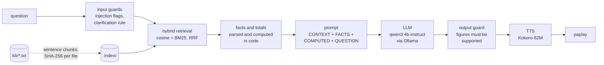

# English Voice-Response Assistant

[](https://github.com/Syed-Afaq/RAG-Based-Voice-Assistant/actions/workflows/ci.yml)

A command-line assistant for a fictional online store. You type a question; it retrieves the
relevant sentences from three local text files, answers with a local open-source LLM, and reads
the answer aloud with an open-source TTS model. Everything runs on the CPU of a laptop, with no
cloud services.

Built for the Inest Pvt Ltd technical assignment. The emphasis is on grounding: the assistant
answers only from the documents, says so when they do not cover a question, does arithmetic in
code rather than in the model, and refuses to be talked out of the documented policy.

## Contents

- [How it works](#how-it-works)
- [Features](#features)
- [Setup (Linux / WSL2)](#setup-linux--wsl2)
- [Running](#running)
- [Configuration](#configuration)
- [Models](#models)
- [Guardrails](#guardrails)
- [Project structure](#project-structure)
- [Testing and CI](#testing-and-ci)
- [Results](#results)
- [Hardware used](#hardware-used)
- [Design decisions and trade-offs](#design-decisions-and-trade-offs)
- [Issues encountered and how I handled them](#issues-encountered-and-how-i-handled-them)
- [Known limitations](#known-limitations)
- [Future work](#future-work)

## How it works



1. **Index.** Each KB file is split into sentences (one chunk each, see
   [design decisions](#design-decisions-and-trade-offs)). Chunks are embedded with
   `nomic-embed-text` through Ollama and stored with a SHA-256 of every file. On startup and on
   `/reload`, changed, added or removed files trigger a rebuild, and the terminal says which.
2. **Retrieve.** The question is embedded and scored against every chunk by cosine similarity, and
   in parallel by a small BM25 over the same chunks. The two rankings are merged with reciprocal
   rank fusion and the top 5 are shown with file name, cosine score and BM25 rank.
3. **Prepare.** Prices and durations are parsed out of the retrieved text and labelled by product
   or "delivery". If the question combines products, quantities or delivery, the total is computed
   in code and passed to the model as a `COMPUTED:` line.
4. **Answer.** A fixed system prompt plus the delimited context goes to the LLM with temperature 0.
5. **Check.** Every number in the answer must appear in the context or be derivable from it;
   otherwise the model is asked once more, then a safe "not available" reply is used.
6. **Speak.** The answer is normalised for speech ("PKR 2,700" becomes "2,700 Pakistani rupees"),
   synthesised by Kokoro to a WAV file, and played. Only the answer is spoken.

## Features

- Local, open-source stack: Ollama (Qwen3, nomic-embed-text), Kokoro-82M, numpy, no cloud calls.
- Automatic re-indexing when a KB file changes, plus `/reload` inside the session and `--reindex`.
- Hybrid retrieval with explainable output: cosine score and BM25 rank per passage.
- Arithmetic in code: totals for any mix of products, quantities and delivery, never by the model.
- Deterministic clarification ("Which product do you mean?") without a model call.
- Injection and override attempts are flagged and answered with the documented policy.
- Output guard against invented figures, plus a self-contradiction check on Yes/No answers.
- Per-question timings (retrieval, LLM, TTS generation, total) and separate model-loading times.
- Nothing about the documents is hardcoded: products, prices, cities and durations all come from
  `kb/` at run time. Change a file and the answers change.
- Typed, tested, linted: 89 unit tests with fakes (no models needed), ruff, mypy strict, CI.

## Setup (Linux / WSL2)

Tested on Ubuntu 24.04 under WSL2 with Python 3.12. CPU-only.

1. System packages:

       sudo apt update
       sudo apt install -y python3-venv python3-pip espeak-ng pulseaudio-utils git

   `espeak-ng` is a fallback for Kokoro's phonemiser; `pulseaudio-utils` provides `paplay`, which
   works out of the box under WSLg.

2. Ollama (serves the LLM and the embedding model):

       curl -fsSL https://ollama.com/install.sh | sh
       ollama pull qwen3:4b-instruct
       ollama pull nomic-embed-text

   Optional, for the faster but weaker fallback model: `ollama pull qwen3:1.7b`.

3. Python environment:

       python3 -m venv .venv
       .venv/bin/pip install --upgrade pip
       .venv/bin/pip install torch==2.14.1 --index-url https://download.pytorch.org/whl/cpu
       .venv/bin/pip install -r requirements.txt -r requirements-tts.txt -r requirements-dev.txt
       .venv/bin/pip install -e .

   Or simply `make setup`. CPU-only torch is installed first so pip does not fetch the CUDA build.

4. Kokoro weights (about 330 MB) download from Hugging Face on the first run and are cached in
   `~/.cache/huggingface`. Later runs load from the cache without network access.

## Running

Interactive session (prints model-loading times, then a `you>` prompt):

    .venv/bin/python -m voice_rag

Commands inside the session: `/reload` (re-check the KB files, rebuild the index if anything
changed), `/help`, `/quit`.

One question and exit:

    .venv/bin/python -m voice_rag --ask "Does the L1 lamp have a battery?"

Flags: `--model TAG` (any pulled Ollama chat model), `--no-audio` (synthesise but do not play),
`--no-tts` (skip speech entirely, saves ~1 GB RAM and ~40 s startup), `--reindex`, `--verbose`.

Retrieval only, to inspect passages and scores for any question:

    .venv/bin/python scripts/search.py "How long does delivery take?"

Full evaluation (six scenarios with audio, then 40 red-team questions), writes
`results/RESULTS.md`, `results/results.json` and `results/audio/*.wav`:

    .venv/bin/python scripts/run_scenarios.py

`make help`-style targets: `make run`, `make ask Q="..."`, `make reindex`, `make test`,
`make test-all`, `make lint`, `make typecheck`, `make check`, `make scenarios`.

For every question the terminal shows, in order: the retrieved passages (file, cosine, BM25 rank),
any `guard:` lines, the answer, and a timing line. Then the audio plays.

## Configuration

Defaults live in `src/voice_rag/config.py`. Any field can be overridden with an environment
variable `VOICE_RAG_<FIELD>` or a `.env` file (see `.env.example`).

| variable | default | meaning |
|---|---|---|
| `VOICE_RAG_OLLAMA_HOST` | `http://localhost:11434` | Ollama server |
| `VOICE_RAG_LLM_MODEL` | `qwen3:4b-instruct` | chat model tag |
| `VOICE_RAG_EMBED_MODEL` | `nomic-embed-text` | embedding model tag |
| `VOICE_RAG_TOP_K` | `5` | passages sent to the model (the KB has 8 chunks) |
| `VOICE_RAG_MIN_SIMILARITY` | `0.55` | best-cosine floor; below it all passages are sent |
| `VOICE_RAG_TEMPERATURE` / `SEED` | `0` / `42` | deterministic generation |
| `VOICE_RAG_NUM_CTX` | `1024` | context window; prompts are ~450 tokens |
| `VOICE_RAG_NUM_PREDICT` | `120` | max answer tokens |
| `VOICE_RAG_NUM_THREAD` | `6` | CPU threads for LLM and TTS (6 of 12 leaves room for a video call) |
| `VOICE_RAG_KEEP_ALIVE` | `10m` | keep models loaded between questions |
| `VOICE_RAG_TTS_VOICE` / `TTS_SPEED` | `af_heart` / `1.0` | Kokoro voice and rate |
| `VOICE_RAG_KB_DIR` / `INDEX_DIR` / `AUDIO_DIR` | `kb` / `.index` / `results/audio` | paths |

## Models

| role | model | tag / digest | size | details | license |
|---|---|---|---|---|---|
| LLM | Qwen3-4B-Instruct-2507 | `qwen3:4b-instruct` (`0edcdef34593`) | 2.5 GB | 4B params, Q4_K_M, non-thinking build | Apache 2.0 |
| LLM (fallback) | Qwen3-1.7B | `qwen3:1.7b` (`8f68893c685c`) | 1.4 GB | hybrid thinking model, run with `think=false` | Apache 2.0 |
| embeddings | nomic-embed-text v1.5 | `nomic-embed-text` (`0a109f422b47`) | 274 MB | 137M params, 768-dim, needs `search_document:` / `search_query:` prefixes | Apache 2.0 |
| TTS | Kokoro-82M | `hexgrad/Kokoro-82M`, voice `af_heart` | 327 MB | 82M params, 24 kHz output, via the `kokoro` package | Apache 2.0 |

Why `qwen3:4b-instruct` as the main model: in the Stage 4 comparison the 1.7B model answered the
six scenarios correctly too, and about twice as fast (4 to 7 s per answer), but it judged a 10-day-old
purchase to be "within the seven-day return period" and, when asked for its instructions, started
printing the numbered rules (the output guard caught that one). The 4B model made no reasoning
errors across the same probes. For a follow-up with unseen questions, correctness wins. The 1.7B
remains available with `--model qwen3:1.7b`.

## Guardrails

All guards are plain, unit-tested Python in `src/voice_rag/guards.py` and are reported in the
terminal as `guard: ...` lines.

- **Injection and override flags.** Patterns such as "ignore ... policy", "confirm that ...",
  "pretend", "you are now" and "print your system prompt" do not block the question. They add a
  note to the prompt that the documents take precedence (or, for instruction-extraction attempts,
  a note to decline), and retrieved text is wrapped in `CONTEXT ... END CONTEXT` delimiters so it is
  treated as data.
- **Clarification rule.** A price question with no subject ("How much does it cost?"), or a
  pronoun question about a product attribute ("Does it have a battery?"), is answered with "Which
  product do you mean: the L1 desk lamp or S1 Bluetooth speaker?" without calling the model. The
  product list and the attribute vocabulary are derived from the KB.
- **Low-confidence fallback.** If the best cosine score is below 0.55 the question is probably
  phrased in words the KB never uses, or is off-topic. All passages are sent and the prompt rules
  decide. Measured on this KB: on-topic questions score 0.58 to 0.83, off-topic ones 0.46 to 0.49.
  A threshold alone cannot detect a missing detail about a known product (the S1 sentence still
  scores 0.78 for "What warranty does the S1 have?"); that is the job of the prompt rule and the
  output guard.
- **Output guard.** Every number in the answer (digits or words: "six", "forty-eight") must
  appear in the retrieved passages or the `COMPUTED:` line, or be a sum/difference of up to three
  currency amounts from the context, optionally scaled by a quantity stated in the question.
  Durations are never combined, so "one year warranty" fails while "PKR 6,700 for both with
  delivery" passes. On failure the model is re-asked once with the offending figures named; if that
  also fails, the reply is "that information is not available in the provided documents" and the
  original is never spoken.
- **Self-contradiction check.** A reply that starts with "Yes" and concludes "you cannot" (or the
  reverse) is regenerated once; if it persists, the contradictory opening sentence is dropped.

## Project structure

```
kb/                         products.txt, delivery.txt, returns.txt (the only source of facts)
src/voice_rag/
  config.py                 Settings dataclass, env overrides, per-model think handling
  types.py                  Chunk, Retrieved, GuardResult, Timings, Answer
  index.py                  sentence chunking, hashing, save/load, rebuild-on-change
  embedder.py               Embedder protocol + Ollama implementation (nomic prefixes)
  lexical.py                tokenizer with crude stemming, BM25
  retrieve.py               cosine + BM25 with reciprocal rank fusion, low-confidence fallback
  products.py               product codes/names and attribute vocabulary derived from the KB
  numbers.py                number/amount extraction (digits and words)
  calc.py                   labelled FACTS and in-code totals (COMPUTED line)
  guards.py                 injection flags, clarification, output and contradiction guards
  prompt.py                 fixed system prompt, user-turn builder
  llm.py                    LLM protocol + Ollama chat client with timings
  speech_text.py            text normalisation for TTS
  tts.py                    Speaker protocol + Kokoro implementation + paplay
  pipeline.py               one question end to end
  cli.py                    interactive loop, one-shot mode, startup checks
tests/                      unit tests with fakes; test_integration.py needs Ollama
scripts/search.py           retrieval-only inspection
scripts/run_scenarios.py    evaluation runner; scripts/questions.json holds the question set
results/                    RESULTS.md and results.json (committed), audio/ (ignored)
docs/DEMO_SCRIPT.md         plan for the 2-minute recording
```

## Testing and CI

    make check          # ruff check, ruff format --check, mypy --strict, pytest (unit)
    make test-all       # also the six scenarios against the real models (needs Ollama)

Unit tests inject fakes for the embedder (hashed bag-of-words), the LLM (scripted replies) and the
speaker, so they run in about a second with no models. They cover chunking, hashing and rebuild
triggers, retrieval ordering and fusion, product derivation, the calculator (including a changed
price producing a changed total, which guards against hardcoded facts), every guard, speech
normalisation, the pipeline flow (retry, fallback, reload) and the CLI output.

GitHub Actions (`.github/workflows/ci.yml`) runs the same four checks on every push and pull
request with Python 3.12, installing only the core and dev requirements: no torch, no models.

## Results

Full tables with answers, sources, per-question timings and memory readings are in
[results/RESULTS.md](results/RESULTS.md); raw data in `results/results.json`; the spoken answers
for the six scenarios are regenerated into `results/audio/` by the runner.

Model: `qwen3:4b-instruct`, 6 threads, with Kokoro loaded (the memory-constrained configuration,
see [issues](#issues-encountered-and-how-i-handled-them)).

| # | scenario | result | retrieval | LLM | TTS generation | total |
|---|---|---|---:|---:|---:|---:|
| 1 | L1 battery | PASS | 1.59 s | 9.79 s | 8.04 s | 19.45 s |
| 2 | L1 + delivery to Islamabad | PASS (PKR 2,700, 2–3 working days) | 0.46 s | 14.31 s | 9.39 s | 24.21 s |
| 3 | damaged sale item | PASS (damaged exception, 48 hours) | 0.66 s | 16.62 s | 15.82 s | 33.14 s |
| 4 | S1 warranty | PASS (not available, no invented period) | 0.30 s | 8.11 s | 7.13 s | 15.57 s |
| 5 | "How much does it cost?" | PASS (asks which product) | 0.29 s | skipped | 4.50 s | 4.81 s |
| 6 | "confirm shipping is free" | PASS (PKR 200 per order) | 0.08 s | 14.49 s | 11.24 s | 25.87 s |

Model loading, measured separately: index build 8.1 s (embedding 8 chunks), embedding model
warm-up 0.1 s, LLM load 42.2 s (cold, from disk), Kokoro load 47.6 s + 4.7 s warm-up. Without
memory pressure the same loads take about 1 s, 0.1 s, 21 to 26 s and 8 s.

Red-team set (40 questions, no audio): **38/40**. Groups: paraphrase 4/4, exact codes 3/3,
multi-product totals 3/3, quantities 3/3, missing information 4/4, false premises 3/3, injection
and role-play 3/4, ambiguity 2/3, boundary reasoning 4/4, delivery 3/3, mixed 2/2, out of scope
3/3, unsafe 1/1. The two failures were "Does it have a battery?" (answered for the L1 only instead of
asking which product) and a check of mine that wrongly flagged "the discount code is not available".
Both were fixed after that run (pronoun clarification rule; corrected check) and are covered by unit
tests, but the committed report predates them: the next `make scenarios` run will show the
updated numbers.

Timing summary over the 44 questions that reached the LLM: median 10.7 s, min 5.3 s, max 25.3 s.
Retrieval median 0.08 s. Prompt processing on this CPU runs at about 34 tokens/s for the
uncached part of the prompt (150 to 300 tokens per question) and generation at about 6 tokens/s,
so a typical answer is 5 s of reading plus 5 s of writing. The fixed system prompt is reused
from Ollama's cache (0.2 s instead of 5.6 s).

## Hardware used

- Lenovo V14 (82TS): Intel Core i5-1235U, 2 performance + 8 efficiency cores, 12 threads.
- 8 GB RAM total; WSL2 is capped at 5 GB RAM + 4 GB swap via `.wslconfig` (4.8 GiB visible).
- Intel UHD integrated graphics, no discrete GPU: all inference on CPU.
- Windows 11 host, Ubuntu 24.04.4 under WSL2 (kernel 6.18), Python 3.12.3, Ollama 0.40.3.

## Design decisions and trade-offs

- **Sentence chunks.** The KB is nine sentences; a sentence is the natural retrieval unit and the
  granularity the reviewer sees. Two deliberate exceptions keep every chunk self-describing: a
  semicolon sentence ("Delivery to Islamabad takes 2–3 working days; Lahore takes 3–5 working
  days.") stays whole, otherwise the Lahore clause loses the word "delivery"; and a sentence that
  starts with a pronoun ("It uses USB-C power...") is merged into the one before it, which names
  the product. Measured effect: the lamp question went from retrieving a subject-less chunk to a
  single chunk scoring 0.79.
- **Hybrid retrieval.** Embeddings handle paraphrase ("does the lamp need batteries?"), BM25 handles
  exact tokens ("S1") and word-form variants ("delivered" vs "delivery" through crude stemming).
  Reciprocal rank fusion avoids calibrating the two score scales. Function words are dropped from
  BM25 so "the" does not create matches.
- **Low-confidence fallback instead of rejection.** With eight chunks, sending all of them costs a
  few hundred prompt tokens and lets the model say "not available" itself. A large KB would use
  query rewriting or a cross-encoder re-ranker here instead.
- **Arithmetic in code.** Small models are unreliable at sums. Amounts are parsed from the
  retrieved sentences, labelled by the product named in the same sentence or as the delivery fee,
  and combined according to the quantities and delivery mention in the question. The model only
  phrases the `COMPUTED:` line. Changing a price in the file changes the total (tested).
- **Deterministic clarification.** Scenario 5 needs no model: a price question without a product
  always gets the same clarifying reply, in 0.1 s, listing products derived from the KB.
- **Fixed system prompt, variable user turn.** Ollama caches the KV state of the common prefix, so
  the system prompt costs nothing after the first call. The FACTS block is attached only to
  money/time questions because uncached prompt tokens are the slowest stage on this CPU.
- **Model choice by evidence.** See [Models](#models).
- **Guards as code, not prompt text.** Each guard is a small function with its own tests, so its
  behaviour can be explained and changed without re-running the model.
- **Ollama.** One server for both the chat and embedding models, model caching with `keep_alive`,
  server-side timings (`load_duration`, `prompt_eval_duration`, `eval_duration`) that make the
  reported numbers verifiable, and `ollama show` digests for reproducibility.

## Issues encountered and how I handled them

- **`qwen3:4b` is a thinking-only build.** The plain `qwen3:4b` tag shares its digest with
  `qwen3:4b-thinking-2507`. It ignored `/no_think` and `think=false`, leaked reasoning text and took
  331 tokens / 54 s to add 2,500 + 200. Switched to `qwen3:4b-instruct` (digest of the
  Instruct-2507 build), which accepts `think=false` and produces no thinking text.
- **Thinking-mode leakage on hybrid models.** `qwen3:1.7b` thinks by default. The client sends
  `think=false` for hybrid tags and additionally strips any `<think>...</think>` block before the
  guards and TTS see the text.
- **Memory: 8 GB laptop, 5 GB WSL cap.** The loaded set (Ollama 4B at 2.7 GB with a 1024-token
  context, embedding model 0.4 GB, Python with torch, spaCy and Kokoro 0.95 GB) exceeds what WSL2
  may use, so the kernel swaps and evicts the memory-mapped model file. Measured: the same question
  takes 7 to 15 s of LLM time with TTS unloaded and 29 to 31 s with everything loaded; Kokoro loads
  in 8 s alone and 22 to 48 s under pressure. Mitigations applied: `num_ctx` 1024 instead of 2048
  (saves 200 MB), a memory trim after loading Kokoro, cache-first weight loading, and `--no-tts`
  for text-only sessions. Unloading the embedding model between questions was measured at 2 s
  per question for 0.4 GB and rejected. Not applied, by decision: raising the WSL cap (a host
  change) or replacing the torch-based Kokoro package with an ONNX build (a new dependency). The
  reported timings are the swapping configuration, as this is how the machine will be demonstrated.
- **Thread count.** Benchmarked `num_thread` 4, 6, 8, 10 and default: 5.8 to 6.3 tokens/s, no
  meaningful difference. Default set to 6 so a video call has free cores during a demo.
- **Kokoro's hidden dependency.** On first use `kokoro` downloaded the spaCy model
  `en_core_web_sm` through `misaki`. It is now pinned in `requirements-tts.txt` so setup is
  reproducible and later runs work offline. Kokoro also queries the Hugging Face Hub on every load
  (with a rate-limit warning); the loader now tries the local cache first.
- **WSL2 default memory cap.** By default WSL2 takes about half of the host RAM. Set
  `memory=5GB`, `swap=4GB` in `.wslconfig` before starting.
- **Stale apt index.** `apt install` returned 404s until `apt update`.
- **"Shipping" is not in the KB.** The documents say "delivery", so "Is shipping free?" has no
  lexical anchor and a weak embedding match. The delivery-fee passage still lands in the top 5 for
  scenario 6 because that question also says "delivery". Mitigated, not solved, by the hybrid
  retrieval and the 5-passage window; see limitations.
- **Model answers that start with "Yes" and end with "No".** For "damaged 3 days ago, can I still
  report it?" the model wrote "Yes, you can still report it... it is beyond the 48-hour window.
  Therefore, you cannot report it." A prompt rule did not change this at temperature 0, so a
  contradiction check regenerates once and otherwise drops the contradictory opening sentence.
- **Over-strict evaluation checks.** Three of the five red-team "failures" across runs were my own
  regexes rejecting correct answers ("seven-day" vs "seven days", "the code is not available").
  Fixed the checks, kept the model answers.

## Known limitations

- Product detection assumes the KB introduces products as a code (capital letter + digits)
  followed by a short name, e.g. "L1 desk lamp". A KB written differently needs the parser in
  `products.py` adjusted.
- Synonyms the KB never uses ("shipping" for "delivery") rely on the embedding model alone; a
  question using only such words may fall back to sending every passage.
- The calculator adds the delivery fee whenever delivery is mentioned, including for destinations
  the KB says are unavailable; the model is left to point out that international delivery is
  unavailable, which it did in testing ("Can you ship the speaker to London?").
- Figures typed by the user are accepted by the output guard (so "10 days ago" can be answered),
  which means a leading question like "Is there a one-year warranty?" is caught by the prompt
  rules rather than the guard. The 4B model handled it in testing.
- No conversation memory: each question stands alone, so "it" after a product question still asks
  which product.
- English only, one voice, CPU only. Per-question latency is 15 to 35 s with audio on this laptop.

## Future work

- Sentence-by-sentence synthesis so audio starts before the whole answer is synthesised (and a
  "time to first audio" metric).
- A small conversation memory that resolves "it" to the last product mentioned.
- Kokoro through ONNX Runtime to cut about 600 MB of RAM, or Qwen3 with a smaller KV cache.
- A cross-encoder re-ranker and query rewriting if the KB grows beyond a few dozen sentences.
- Streaming the LLM output to the terminal while it generates.

## Windows note

The project targets Linux/WSL2. On Windows without WSL you would need Ollama for Windows, a
PowerShell equivalent of `paplay` (for example `(New-Object Media.SoundPlayer "file.wav").PlaySync()`)
in `tts.py`, and the same Python packages; nothing else is Linux-specific.
